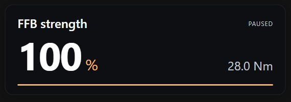

# SimPro Quick Control

Adjust SIMAGIC wheelbase tuning from assignable USB joystick buttons and button-mode encoders while driving. A compact desktop popup and a minimal VR browser page show the selected setting and live value.

**[Download for Windows x64](https://github.com/DSuzuki35/simpro-quick-control/releases/latest/download/SimPro-Quick-Control-Windows-x64.zip)** · [All releases](https://github.com/DSuzuki35/simpro-quick-control/releases) · [Source code](https://github.com/DSuzuki35/simpro-quick-control)

Extract the **entire ZIP**, then run `SimPro Quick Control.exe`. Python is not required for the download. Keep the `_internal` directory beside the executable. The popup uses lightweight native controls; no WebView2 installation is required. This is an unsigned community application.

## Features

- 22 tuning and lighting controls exposed by the tested Alpha EVO Ultra configuration.
- Shared encoder controls with next/previous setting selection, dedicated per-setting pairs, or both.
- Per-setting increments; optional encoder acceleration from 1× to 2×, 5× and 10×.
- Popup inactivity timeout: off, 3, 5, 10 seconds, or custom. Assigned input brings it back without requesting game focus.
- Minimal VR page: setting name, value, configured Nm limit, live/paused status and active acceleration multiplier.
- Local-only operation, portable configuration and a low-resource VR-only mode.



## Quick start

1. Open SimPro Manager and connect the wheelbase.
2. Launch the executable and open **http://127.0.0.1:18761/**. The tray icon also opens settings.
3. In **Button assignments**, click **Learn** beside Increase selected, then turn the encoder one click. Repeat for Decrease selected. Assign Next/Previous to choose settings, or assign dedicated pairs.
4. Click **Enable controls**. Start with small increments and check the result in SimPro.
5. Save your preset in SimPro when you want to retain the tuning.

Controls start paused by default. Connection errors, device removal and uncertain writes pause controls. Auto-enable is optional, as described below.

Encoders must produce joystick button presses; axes and hats are not supported. Holding a button does not auto-repeat. Inputs remain visible to the game, so remove conflicting in-game bindings. Devices with identical reported names/GUIDs are ignored when more than one is connected because their assignments cannot be distinguished reliably.

## Minimal VR overlay

Use **http://127.0.0.1:18761/vr** as a browser source in your VR overlay application. Suggested dimensions: **550 × 210**.

- The card fades after the configured inactivity timeout and returns on assigned input.
- Use **http://127.0.0.1:18761/vr?always=1** to keep it visible.
- The page background is transparent; whether that transparency reaches the headset depends on the overlay host.
- This is a browser page, not a SteamVR/OpenXR injector. Your overlay application supplies headset placement and capture.
- Nm is the **configured maximum output**, not measured instantaneous torque.

For minimum overhead, quit the normal controller and launch **Start VR only.cmd**. This runs the input and SimPro service without the desktop popup/tray. Open the control page to configure it; **Display → Quit controller** stops it. Do not start both modes at once.

## Automatic startup

Under **Display → Startup & connection**:

- **Start with Windows** registers this executable in the current user's login startup. It starts quietly and waits for SimPro; no administrator rights are required. Disable the option before moving or deleting the portable app folder. Re-enable it from the new location afterward.
- **Auto-enable when SimPro connects** makes assigned controls ready on initial connection or reconnection. It is off by default. A manual pause lasts until you enable controls or restart the app. An unconfirmed write remains paused until explicit enable, even if SimPro reconnects.

Together these options provide “ready when SimPro starts” behavior. There is no modification to SimPro's installation or launcher. Enabling login startup does not by itself enable adjustments.

## Encoder acceleration

Enable the toggle under **Button assignments**. It is off by default.

With at most 160 ms between consecutive clicks in the same direction on the same setting/device, the 4th click uses 2×, the 8th 5×, and the 16th 10× the configured increment. A pause, reversal or target change resets the ramp. Choice settings do not accelerate. All output remains clamped to the setting's range.

## Compatibility

**Optimized and hardware-tested with SimPro Manager 3.2.4.13771 and Alpha EVO Ultra, firmware V2.3.6 (28 Nm).**

The app reads SimPro's version and shows a compatibility note. Other versions are **experimental, not blocked by version number**. Unknown version metadata does not prevent adjustment when the required API and settings are available. Compatibility tests cover a different version string, but that does not replace testing another installed SimPro release.

This adapter uses the local `/simpro/api/v3` interface. Versions that remove or change that interface may not work; SimPro 2 is not verified. Missing settings are omitted. This first release is restricted to the tested **Alpha EVO Ultra hardware model** because ranges and meanings on other bases have not been verified. The software-version policy and hardware-model check are separate.

The integration is unofficial and is not affiliated with or endorsed by SIMAGIC. SimPro's local API may change. No calibration, firmware update or torque-unlock actions are exposed.

## Telemetry FFB

The installed SimPro configuration contains built-in effects for FFB detail, understeer/oversteer, crash/curb protection, ABS, wheel lock/spin, gear shifts and RPM vibration. Exposing those native effect settings is a possible future extension.

**This release does not inject telemetry-generated forces.** A configuration API does not establish a supported high-frequency torque streaming API; arbitrary live force injection through SimPro has not been verified.

## Performance and behavior

- The adjustment worker sleeps until input or its next background refresh.
- SimPro refresh is once per second while enabled and once every two seconds while paused. Version metadata is cached for 60 seconds.
- Only assigned USB controllers are kept open; learning temporarily opens eligible devices. USB event polling uses an 8 ms active / 50 ms paused interval. The native popup checks visibility at 10 Hz without copying the full state while hidden.
- Hidden browser tabs poll every two seconds. The visible VR page polls at 5 Hz. The native popup has no embedded browser engine.
- Repeated encoder changes do not rewrite unchanged configuration files. Adjacent ticks in the same direction can be coalesced; opposite directions remain ordered.
- Writes always read fresh configuration and require readback confirmation. No automatic retry of uncertain writes. Input older than 750 ms is discarded.

The normal popup uses Tk native controls. VR-only mode omits the popup and tray; memory used by your external VR/browser host is separate. See [measured resource use](docs/performance.md).

## Configuration and troubleshooting

Local preferences are in `data/config.json` beside the executable. Logs are in `data/controller.log`. These files are not part of the source repository or release archive. Reverse direction at zero strength is remembered during the current app session because SimPro represents zero without a sign.

Keep SimPro open. If another instance is already running, launching again opens its control page. A desktop popup may be covered by an exclusive-fullscreen game; use borderless/windowed mode or the VR browser source. Drag the group or status text along the top of the popup to position it.

The server listens only on `127.0.0.1` and checks Host, Origin and a per-session API token. Do not expose the server publicly. No analytics or cloud service is used.

## Development

On Windows with Python 3.12:

```powershell
python -m venv .venv
.venv\Scripts\python -m pip install -r requirements-lock.txt
.venv\Scripts\python -m pytest -q
.venv\Scripts\python main.py
```

Build the executable and distributable ZIP:

```powershell
.venv\Scripts\python tools\build_release.py
```

Output: `dist/SimPro-Quick-Control-Windows-x64.zip`. See [architecture](docs/architecture.md) for the module map and integration contract. The release source is tagged alongside the binary.

Tests cover control limits, sign handling, mappings, acceleration, queue ordering/expiry, disconnect handling, inactive visibility, readback confirmation, HTTP protection and avoiding unnecessary disk writes. Physical encoder timing, headset rendering and other SimPro releases still need testing on each user's setup.

## AI assistance disclosure

This project was coded with help from AI using **OpenAI Codex and ChatGPT**. AI assistance is not a guarantee of correctness. Review the source, test incrementally and report reproducible problems. This acknowledgment is documentation-only and does not appear in the application interface.

## License

Project source: [MIT](LICENSE). Bundled third-party components retain their own licenses, included in the release's `THIRD-PARTY-LICENSES` directory.
